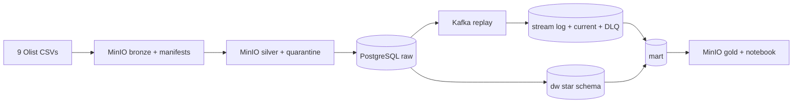

# Olist Data Platform

An auditable batch and streaming platform for the Brazilian Olist marketplace dataset. Nine source CSV files flow through append-only bronze objects, typed silver Parquet with quarantine, PostgreSQL raw tables, Kafka order events, a dimensional warehouse, and dashboard-ready marts.



## Run from zero

Local prerequisites: Python 3.10+, PostgreSQL 16 (`Postgres.app` is supported), Kafka, and MinIO. On macOS the latter two can be installed with `brew install kafka minio`. The service manager reuses those binaries and keeps all runtime data in ignored `data/local/`; Docker is not required.

```bash
python3 -m venv .venv
.venv/bin/pip install -r requirements.txt
.venv/bin/python scripts/get_dataset.py
.venv/bin/python pipeline.py init
.venv/bin/python pipeline.py up
.venv/bin/python pipeline.py all
.venv/bin/python pipeline.py inject
.venv/bin/pytest -q
```

PostgreSQL, Kafka, and MinIO all run as local processes. Kafka UI is optional and is the only Docker service in the normal workflow. Start it after `pipeline.py up` with:

```bash
docker compose -f docker-compose.kafka-ui.yml up -d
```

Open `http://localhost:18080`. Stop it with `docker compose -f docker-compose.kafka-ui.yml down`; its compose file has no database, broker, or object-store volumes.

Ports are configured in `.env`; committed defaults are in `.env.example`. Generated evidence is under `outputs/`. Individual stages are `check`, `profile`, `bronze`, `silver`, `load`, `stream`, `model`, `marts`, `dashboard`, and `report`.

## Design answers

### T0 — silent correctness risks

Using `customer_id` as a person overcounts customers: it has 99,441 values while `customer_unique_id` has 96,096. Joining item, payment, and review rows before aggregation creates many-to-many multiplication and inflates money. Treating missing delivery dates as on time lowers late rate. Treating ZIP codes as numbers drops leading zeroes and breaks geography joins. Treating `review_id` as unique ignores 1,603 participating rows and can multiply review joins.

### T1 — append-only bronze

Bronze preserves the exact source and a versioned checksum manifest. If an upstream file is corrected after a dashboard changes, its prior version reproduces the old number and allows an exact comparison.

### T2 — gate threshold

The hard-rule quarantine threshold is 2% per table. Small localized defects are preserved in quarantine and processing continues; more than 2% indicates a broken source and stops before PostgreSQL changes. A handful of invalid coordinates passes with quarantine; a missing required column fails immediately.

### T3 — consumer crash

The consumer commits PostgreSQL first and the Kafka offset second. If it crashes between them, Kafka redelivers. `event_id` is deterministic and primary-key protected, so conflict handling makes replay harmless; current status only advances by rank. DLQ publishing is not exactly-once and can duplicate on a crash. The database DLQ keeps diagnostics, and duplicates are acceptable because DLQ data is inspected rather than aggregated.

### T4 — review policy

`fact_review` keeps the latest answered review per order and stores `review_count`. This provides one row per order and deterministic reruns. Averaging all reviews was rejected because it weights multi-review orders more heavily in Q2.

### T5 — reconciliation

The mart uses BRL 0.01 tolerance and classifies differences as matched, no items, no payment, voucher, installments, or unexplained. The exact unexplained total is generated in `outputs/marts_report.md`. Finance should clarify voucher adjustments, fees absent from item data, and how cancellations or refunds appear.

### T6 — 100× data and a 60-second SLA

Pandas would become memory-bound, so conversion moves to partitioned Spark or Polars workers. Full PostgreSQL rebuilds would exceed the SLA, so loads become incremental CDC-backed merges into time-partitioned tables. A single Kafka broker and Python consumer would saturate, so Kafka becomes a replicated cluster with more partitions and horizontally scaled consumers.

## Policies

- Revenue includes delivered and shipped orders; Jan-2017 through Aug-2018 are complete months.
- Customer grain is one person; latest address uses SCD Type 1.
- Geography averages valid points per ZIP; missing prefixes use `UNKNOWN`.
- `is_late` compares dates and stays null when delivery is unknown.
- RFM frequency uses fixed bands because one-order ties make raw quintiles arbitrary.

## AI assistance

Codex helped structure the centralized contract, pipeline modules, SQL models, tests, and documentation. The implementation was adjusted against the real dataset and generated evidence. Every decision should be reviewed and understood before a demo.
